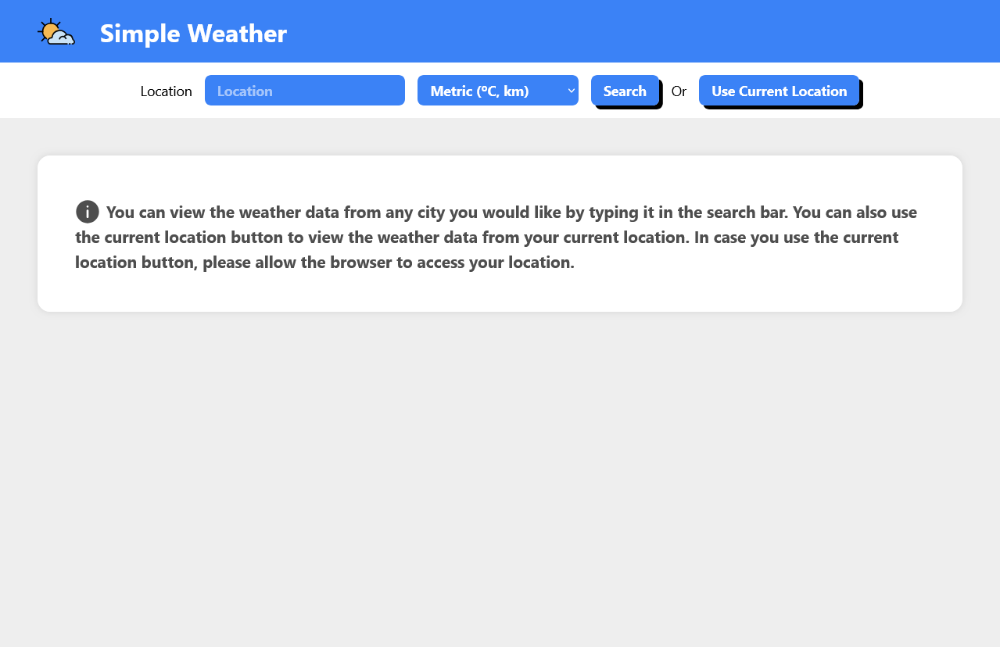
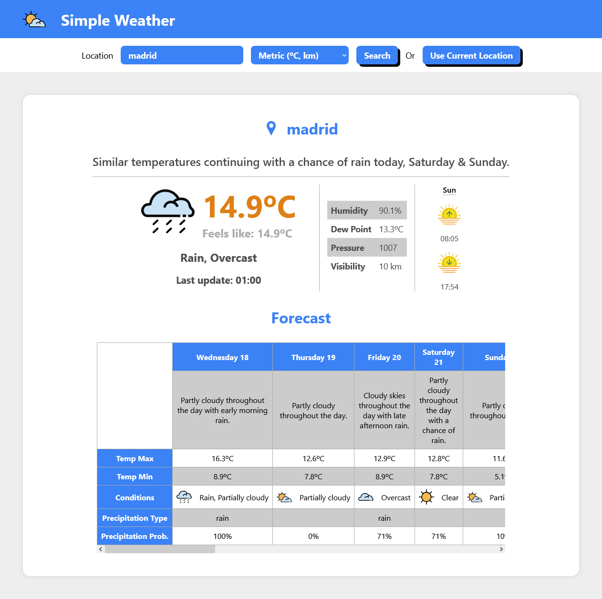

# Weather App - Async JavaScript & API Integration Deep Dive

A modern weather application built with Webpack, demonstrating asynchronous JavaScript patterns including Promises, async/await, API integration, error handling, and code linting.

## Learning Objectives

This project was specifically designed to demonstrate and practice:

- **Linting** - ESLint configuration and code quality enforcement
- **Asynchronous JavaScript** - Callbacks, Promises, and the Event Loop
- **Working with APIs** - Understanding APIs, authentication, fetch(), and CORS
- **Async/Await** - Creating async functions, keywords, return types, error handling

## Live Demo

[View Live Demo](https://leandroesposito.github.io/top-weather-app/)

## Screenshots




## Project Architecture Overview

### 1. Linting (ESLint)

The project uses **ESLint** for code quality and consistency:

```javascript
// eslint.config.mjs - ESLint 9+ flat config format
import globals from "globals";
import pluginJs from "@eslint/js";

export default [
  { languageOptions: { globals: globals.browser } },
  pluginJs.configs.recommended, // Uses recommended rules
];
```

**ESLint configuration includes:**

- `globals.browser` - Defines browser-specific global variables (window, document, fetch)
- `pluginJs.configs.recommended` - ESLint's recommended rule set
- Enforces consistent code style and catches common errors
- Helps prevent bugs like unused variables, undefined globals

### 2. Asynchronous JavaScript

#### The Event Loop

The project demonstrates the **JavaScript Event Loop** in action:

```javascript
// index.js - Demonstrating async nature of the event loop
function validateForm() {
  console.log("validating", new Date()); // Synchronous - executes immediately
  // ...
}

function submitForm(event) {
  event.preventDefault();
  console.log("submit"); // Synchronous

  if (validateForm()) {
    showLocationWeather(locationInput.value, unitInput.value);
    // This starts an async operation - doesn't block the UI
    // The form submit function completes while the API call runs
  }
  console.log("Form submitted, waiting for data...");
  // This logs BEFORE the API response arrives!
}

// Output order:
// "validating"
// "submit"
// "Form submitted, waiting for data..."
// (later) API response received and processed
```

**Event Loop visualization:**

```
Call Stack          Web APIs           Callback Queue        Event Loop
─────────────       ─────────          ──────────────        ──────────
submitForm()    →   fetch()        →   then(callback)    →   move to stack
validateForm()  →   setTimeout()   →   promise.resolve()
console.log()   →   addEventListener
```

#### Callbacks

Traditional callback pattern with the Geolocation API:

```javascript
// index.js - Geolocation API using callbacks
function useCurrentLocation() {
  // navigator.geolocation.getCurrentPosition accepts two callbacks:
  // 1. Success callback - called when location is obtained
  // 2. Error callback - called when location fails
  navigator.geolocation.getCurrentPosition(
    onLocationSuccess, // ← Callback function
    onLocationError, // ← Callback function
  );
}

function onLocationSuccess(location) {
  // This callback executes AFTER the browser gets the location
  // Non-blocking - the rest of the app continues working
  const unitInput = document.getElementById("units");
  showLocationWeather(
    `${location.coords.latitude},${location.coords.longitude}`,
    unitInput.value,
  );
}

function onLocationError(error) {
  renderError(error.message); // Handle the error case
}
```

#### Promises and .then()

The project creates and consumes **Promises**:

```javascript
// data-fetcher.js - Creating a Promise
function fetchData(location, unit = "metric") {
  return new Promise((resolve, reject) => {
    const url = `${baseUrl}${location}?unitGroup=${unit}&key=${API_KEY}`;

    fetch(url, { mode: "cors" })
      .then((response) => {
        if (!response.ok) {
          reject(new Error(`HTTP error! status: ${response.status}`));
        }
        return response.json();
      })
      .then((data) => resolve(data)) // Promise resolves with data
      .catch((error) => reject(error)); // Promise rejects with error
  });
}

// index.js - Consuming a Promise with .then()
function showLocationWeather(location, unit = "metric") {
  renderLoading();

  getWheatherInformation(location, unit).then((data) => {
    // This callback runs when the Promise resolves
    // It executes AFTER the API response arrives
    if ("error" in data) {
      renderError(data.error);
    } else {
      renderData(data, unit);
    }
  });

  // Code here runs IMMEDIATELY while the Promise is pending
  console.log("Loading started, waiting for data...");
}
```

### 3. Working with APIs

#### Understanding APIs

The project integrates with the **Visual Crossing Weather API**:

```javascript
// data-fetcher.js
const API_KEY = "6LGV7CTWHZN4M96CEKSX33LL2";

function fetchData(location, unit = "metric") {
  // API endpoint structure
  const baseUrl =
    "https://weather.visualcrossing.com/VisualCrossingWebServices/rest/services/timeline/";
  const contentType = "json";
  const url = `${baseUrl}${location}?unitGroup=${unit}&key=${API_KEY}&contentType=${contentType}`;

  return fetch(url, { mode: "cors" }).then((response) => {
    // Handle HTTP response status
    if (!response.ok) {
      throw new Error(`HTTP error! status: ${response.status}`);
    }
    return response.json();
  });
}
```

**API Concepts Demonstrated:**

- **API Key Authentication** - Using a secret key for access
- **Endpoint Structure** - `baseURL + location + parameters`
- **Query Parameters** - `?unitGroup=metric&key=API_KEY`
- **Response Format** - JSON data structure
- **Rate Limits** - Understanding API usage constraints

#### CORS (Cross-Origin Resource Sharing)

```javascript
// Using CORS mode to handle cross-origin requests
fetch(url, { mode: "cors" });
```

**CORS explained:**

- Browser security feature that restricts cross-origin requests
- `mode: "cors"` explicitly requests CORS permission
- API must respond with appropriate CORS headers
- Prevents malicious sites from accessing sensitive data

#### fetch() API

```javascript
// Modern fetch() API for network requests
fetch(url, { mode: "cors" })
  .then((response) => {
    // First, check if response is OK
    if (!response.ok) {
      reject(new Error(`HTTP error! status: ${response.status}`));
    }

    // Check content type
    const contentType = response.headers.get("content-type");
    if (!contentType || !contentType.includes("application/json")) {
      reject(new Error("Not a JSON response"));
    }

    return response.json(); // Parse JSON (returns a Promise)
  })
  .then((data) => resolve(data)) // Access parsed data
  .catch((error) => reject(error)); // Handle network errors
```

### 4. Async/Await

The project uses **async/await** for cleaner asynchronous code:

```javascript
// data-fetcher.js - async function declaration
export default async function getWheatherInformation(
  location,
  unit = "metric",
) {
  try {
    // await pauses execution until fetchData Promise resolves
    const data = await fetchData(location, unit);
    return cleanData(data); // Return value becomes the Promise resolution
  } catch (error) {
    console.error("Error in getWheatherInformation:", error.message);
    return { error }; // Can also return error objects
  }
}
```

**Async/Await Keywords:**

- `async` - Declares a function that returns a Promise
- `await` - Pauses execution until a Promise resolves
- `try/catch` - Handles rejected Promises (instead of .catch())

**Return Types of Async Functions:**

```javascript
// Regular function returns a value
function regularFunction() {
  return "Hello"; // Returns string
}

// Async function always returns a Promise
async function asyncFunction() {
  return "Hello"; // Returns Promise<string>
}

// Usage
const result = await asyncFunction(); // "Hello"
// or
asyncFunction().then((result) => console.log(result)); // "Hello"
```

**Error Handling with Async/Await:**

```javascript
// With .then() and .catch()
function showLocationWeather(location, unit) {
  getWheatherInformation(location, unit)
    .then((data) => renderData(data, unit))
    .catch((error) => renderError(error));
}

// With async/await and try/catch
async function showLocationWeather(location, unit) {
  try {
    const data = await getWheatherInformation(location, unit);
    if ("error" in data) {
      renderError(data.error);
    } else {
      renderData(data, unit);
    }
  } catch (error) {
    renderError(error.message);
  }
}
```

### 5. Promise States in Action

```javascript
// Pending - Initial state, neither fulfilled nor rejected
const promise = fetchData("London"); // Promise is PENDING
console.log(promise); // Promise {<pending>}

// Fulfilled - Operation completed successfully
promise.then((data) => {
  console.log(data); // Promise is FULFILLED with value
});

// Rejected - Operation failed
promise.catch((error) => {
  console.log(error); // Promise is REJECTED with error
});
```

## Project Structure

```
weather-app/
├── src/
│   ├── index.js                    # Entry point, event handling
│   ├── data-fetcher.js             # API calls, Promises, async/await
│   ├── render-controller.js        # DOM rendering coordination
│   ├── content-generator.js        # UI element creation
│   ├── style.css                   # Global styles
│   ├── icons.css                   # Weather icon styles
│   ├── template.html               # HTML template
│   └── icons/                      # Weather icon assets
├── eslint.config.mjs               # ESLint 9+ configuration
├── .prettierrc                     # Prettier formatting rules
├── .prettierignore                 # Files ignored by Prettier
├── webpack.common.js               # Shared Webpack config
├── webpack.dev.js                  # Development config
├── webpack.prod.js                 # Production config
└── package.json                    # npm dependencies
```

## Asynchronous Flow Diagram

```
User clicks search
       ↓
submitForm() (synchronous)
       ↓
validateForm() (synchronous)
       ↓
showLocationWeather()
       ↓
renderLoading() (UI updates immediately - not blocking)
       ↓
getWheatherInformation() [async function]
       ↓
fetchData() returns Promise
       ↓
   [Event Loop continues running]
       ↓
    API call in progress...
       ↓
   [User can interact with UI while waiting]
       ↓
Promise resolves/rejects
       ↓
.then() or .catch() callbacks execute
       ↓
renderData() or renderError()
       ↓
UI updates with API response
```

## API Integration Details

### API Request Example

```javascript
// Request
GET https://weather.visualcrossing.com/.../London?unitGroup=metric&key=API_KEY

// Response (simplified)
{
  "resolvedAddress": "London, UK",
  "description": "Partly cloudy throughout the day",
  "currentConditions": {
    "temp": 15.2,
    "feelslike": 14.5,
    "humidity": 72,
    "conditions": "Partially cloudy",
    "icon": "partly-cloudy-day"
  },
  "days": [
    { "datetime": "2024-01-15", "tempmax": 18.3, "tempmin": 11.2 },
    // ...
  ]
}
```

### Data Cleaning Pattern

```javascript
function cleanData(data) {
  // Extract only the data needed for the UI
  return {
    location: data.resolvedAddress,
    description: data.description,
    currentConditions: {
      temp: data.currentConditions.temp,
      feelslike: data.currentConditions.feelslike,
      // ... only necessary fields
    },
    days: data.days.map((day) => ({
      datetime: day.datetime,
      tempmax: day.tempmax,
      tempmin: day.tempmin,
      // ... only necessary fields
    })),
  };
}
```

## Async/Await Best Practices Demonstrated

### Error Handling

```javascript
// Always wrap await in try/catch
try {
  const data = await fetchData(location);
  return cleanData(data);
} catch (error) {
  console.error("Error:", error.message);
  return { error }; // Return error object instead of throwing
}
```

### Parallel vs Sequential Requests

```javascript
// Sequential (current implementation)
const data = await fetchData(location); // Waits for this
const moreData = await fetchMoreData(data); // Then does this

// Parallel (if needed)
const [data1, data2] = await Promise.all([
  fetchData(location1),
  fetchData(location2),
]);
```

### Combining .then() and async/await

```javascript
// The project demonstrates both patterns
// .then() pattern
getWheatherInformation(location).then((data) => renderData(data));

// async/await pattern (cleaner for complex logic)
async function showWeather() {
  const data = await getWheatherInformation(location);
  renderData(data);
}
```

## Linting Output Example

```bash
# ESLint will catch issues like:
$ npx eslint src/

# Errors caught:
# - 'fetchData' is defined but never used
# - Unexpected console statement
# - Missing semicolon
# - 'data' is never reassigned. Use const instead
```

## Webpack Configuration

```javascript
// webpack.dev.js - Development
module.exports = merge(common, {
  mode: "development",
  devtool: "eval-source-map", // Fast source maps for debugging async code
  devServer: {
    watchFiles: ["./src/template.html"],
  },
  module: {
    rules: [
      {
        test: /\.css$/i,
        use: ["style-loader", "css-loader"],
      },
    ],
  },
});

// webpack.prod.js - Production
module.exports = merge(common, {
  mode: "production",
  devtool: "source-map", // Full source maps for production debugging
  optimization: {
    minimizer: [new CssMinimizerPlugin()],
  },
  plugins: [
    new MiniCssExtractPlugin({
      filename: "[name].css",
      chunkFilename: "[id].css",
    }),
  ],
  module: {
    rules: [
      {
        test: /\.css$/i,
        use: [MiniCssExtractPlugin.loader, "css-loader"],
      },
    ],
  },
});
```

## npm Scripts

| Script                      | Purpose                            |
| --------------------------- | ---------------------------------- |
| `npm start`                 | Development server with hot reload |
| `npm run build`             | Production build                   |
| `npm run deploy`            | Deploy to GitHub Pages             |
| `npx eslint src/`           | Run ESLint manually                |
| `npx prettier --write src/` | Format code with Prettier          |

## Key Takeaways

### Asynchronous JavaScript

- JavaScript is single-threaded but non-blocking
- The Event Loop manages async operations
- Callbacks are executed after async operations complete
- Promises represent future values
- Async/await is syntactic sugar over Promises

### API Integration

- APIs require authentication (API keys)
- CORS is a browser security feature
- Always handle network errors gracefully
- Clean/filter API data before using in UI
- Show loading states during async operations

### Linting

- ESLint catches errors before runtime
- Consistent code style improves maintainability
- Prettier automates code formatting
- Linting configs can be shared across projects
